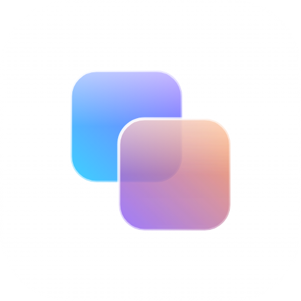

<p align="center">
  
</p>

<h1 align="center">GlassMarshmallow</h1>

<p align="center">
  A CSS framework with glass surfaces, a pastel palette, light and dark mode<br>
  and WCAG 2.2 accessibility (AA, and AAA whenever possible) from the first component.
</p>

<p align="center">
  Plain CSS with the <code>gm-</code> prefix · optional dependency-free scripts · its own icon set<br>
  Components in the Bootstrap style and utilities in the Tailwind style
</p>

<p align="center">
  <a href="https://github.com/spyamuza/portfolio-ia-template">Example: AI portfolio template</a> ·
  Docs and icons: coming soon with v0.1
</p>

```sh
npm install glassmarshmallow
```

```html
<link rel="stylesheet" href="dist/css/glassmarshmallow.min.css">
```

Icons live in their own project, `glassmarshmallow-icons` (published with v0.1).

## Structure

Organised like [Bootstrap](https://github.com/twbs/bootstrap):

| Folder | Content |
| --- | --- |
| `css/` | Source: tokens, base, components and background |
| `dist/` | Compiled files (`npm run css`) |
| `site/` | The documentation website (Angular) |
| `build/` | Build scripts |
| `skills/` | Step-by-step guides for AI coding agents (see `AGENTS.md`) |

## Development

```sh
npm run css     # build dist/css
npm run site    # documentation site at http://localhost:4500
```

## License

MIT · Designed and developed by Sara Paez Yamuza
